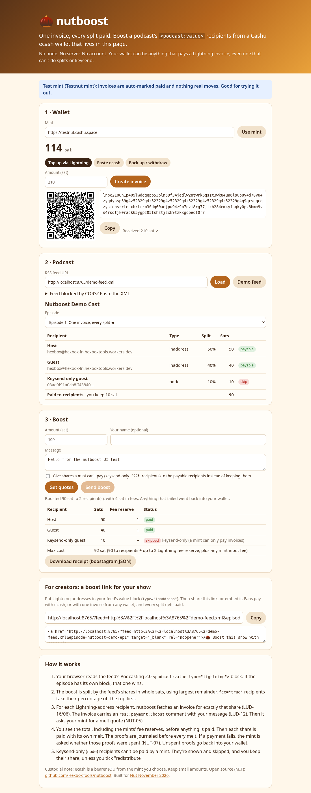
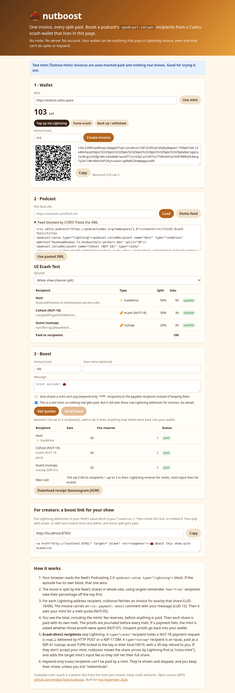

# 🌰 nutboost

**One invoice, every split paid.** nutboost reads a podcast's Podcasting 2.0
[`<podcast:value>`](https://podcasting2.org/docs/podcast-namespace/tags/value) block and pays
every Lightning-address recipient its share of your boost. The money comes from a
[Cashu](https://cashu.space) ecash wallet that lives in the browser page.

- **Live demo:** https://hexboxtools.github.io/nutboost/ (starts on the public *test* mint, so nothing real moves)
- **Built for [Nut November 2026](https://nutnovember.org)**, Value4Value track ("Cashu tools for podcasts and creators")
- MIT licensed · static site · no server · no account · no node



<details><summary>Boost with Lightning, NUT-18 and nutzap recipients in one go</summary>


</details>

## Why

Value4Value splits only work if the listener's app can pay several recipients for every boost.
Most wallets people actually use can't do that, and many can't do keysend either: Strike, Cash
App, Wallet of Satoshi, an exchange, a plain web browser. Web listeners and fans on a creator's
own site usually have no split-aware wallet at all.

nutboost puts a small Cashu wallet in the page and makes the mint do the fan-out:

1. **Fund it once.** Pay *one* Lightning invoice from any wallet, or paste a Cashu token.
2. **Pick a show and an episode.** nutboost parses the feed. An item-level value block overrides the channel one.
3. **Boost.** Your boost is split by the feed's shares. For each `lnaddress` recipient, nutboost fetches an
   invoice for exactly their share, with your message as an `rss::payment::boost` comment. Then it pays
   that invoice with a Cashu **melt** (NUT-05).

The creator needs nothing new: no node, no server, no instance. A Lightning address in the feed
is enough, and Podcasting 2.0 [now recommends](https://podcasting2.org/docs/podcast-namespace/examples/value/metadata) Lightning addresses anyway.

## Ecash-direct recipients (no Lightning hop)

A share doesn't have to leave Cashu at all. nutboost also pays two kinds of recipient in ecash:

```xml
<podcast:value type="lightning" method="lnaddress">
  <podcast:valueRecipient name="Host"   type="lnaddress" address="host@wallet.com" split="50"/>
  <!-- NUT-18 payment request: delivered by its HTTP POST or NIP-17 (Nostr DM) transport -->
  <podcast:valueRecipient name="Cohost" type="cashu"  address="creqA…" split="30"/>
  <!-- NIP-61 nutzap: ecash P2PK-locked to the key in the npub's kind:10019, published as kind:9321 -->
  <podcast:valueRecipient name="Guest"  type="nutzap" address="npub1… or nprofile1…" split="20"/>
</podcast:value>
<!-- optional, show level: one NUT-18 request for the whole show (e.g. a nutsplit server splits it) -->
<podcast:txt purpose="cashu">creqA…</podcast:txt>
```

- **Same mint, no Lightning fee.** If the recipient accepts your mint, the share goes over as ecash. Only the
  mint's input fee applies, and nutboost pays it so the recipient nets the full share.
- **Different mint? Cross-mint.** If their NUT-18 mint list is strict, or their kind:10019 lists other mints,
  nutboost melts your ecash to pay a mint quote at *their* mint. Then it mints the share there (already
  P2PK-locked for nutzaps) and delivers it. The target mint's input fee is added, so they still net their share.
- **Safety.** Proofs are journaled before every hand-off. A NUT-18 payee that answers 4xx gets its proofs
  taken back into your wallet. A network error or 5xx leaves them journaled until the mint shows them spent (delivered)
  or 15 minutes pass with them unspent (reclaimed). Nutzaps carry a NUT-11 30-day locktime with *your*
  wallet's key as the refund key. If no relay accepts the nutzap, nutboost republishes it on the next load. Proofs
  stranded at a foreign mint are kept as exportable tokens.
- **Podcast metadata on nutzaps.** NIP-73 `i` tags (`podcast:guid:…`, `podcast:item:guid:…`), and the message
  as `content`. NUT-18 payloads carry the `rss::payment::boost` memo.
- `type="cashu"`/`"nutzap"` aren't in the Podcasting 2.0 spec yet: `valueRecipient type` is an open slug. The
  show-level `<podcast:txt purpose="cashu">` follows the CASHU_STREAMING proposal used by Hopp, Sovereigncast and nutsplit.
  Aliases accepted: `nut18`, `creq` → NUT-18. `nostr`, `npub` → nutzap.

`npm run e2e:ecash` proves all of this against the public test mints. It starts a local Nostr relay and a
local NUT-18 receiver, and every recipient redeems what it got. Output from a real run (Nov 10 2026):

```
paid       40 Host (lnaddress) via lightning
paid       40 Cohost (NUT-18, same mint) via ecash (NUT-18 post)
paid       30 Editor (NUT-18, other mint) via ecash via https://testnut.cashudevkit.org (cross-mint)
paid       30 Guest (nutzap, same mint) via nutzap (NIP-61)
paid       20 Artist (nutzap, other mint) via nutzap via https://testnut.cashudevkit.org (cross-mint)
paid       20 Producer (NUT-18 via NIP-17) via ecash (NUT-18 nostr)
refunded   20 Grumpy (NUT-18, rejects) via ecash (NUT-18 post) — HTTP 400 {"error":"untrusted_mint"}
nutzap @testnut.cashu.space: without key -> locked (good); recipient redeemed 30 sat
nutzap @testnut.cashudevkit.org: without key -> locked (good); recipient redeemed 20 sat
NIP-17 DM payment: recipient redeemed 20 sat
show-level request: paid 21 Show With Server (show ecash request)
```

## What it handles

| Concern | What nutboost does |
|---|---|
| Split math | Whole sats, largest remainder, ties go to the earlier recipient in the feed. `fee="true"` recipients take their percentage off the top. Shares don't need to add up to 100. |
| Ecash recipients | NUT-18 (`type="cashu"`) and NIP-61 nutzap (`type="nutzap"`) shares are paid in ecash, with a cross-mint over Lightning when needed. See above. |
| Keysend-only (`node`) recipients | A mint can only pay invoices, so these are shown and **skipped by default, and you keep that share**. Opt in to *redistribute* to give it to the payable recipients instead. |
| Dust / LNURL limits | Shares below 1 sat, or outside a recipient's `minSendable`/`maxSendable`, are skipped and reported. Nothing is rounded up behind your back. |
| Wrong invoices | The BOLT11 amount must equal the share, and so must the mint's melt quote. Otherwise that line is refused. |
| Fees | You see the total (shares + each melt's `fee_reserve`) **before** anything is paid. Input fees (NUT-02) come from `includeFees`. Unused reserve comes back as NUT-08 change. |
| Partial failure | Proofs are journaled *before* each melt. If a melt errors, nutboost asks the mint about those proofs (NUT-07): unspent ones go back into your wallet (a refund), pending ones stay journaled until `reconcile()` settles them from the melt-quote state. One failed recipient never blocks the others. |
| Reloads | Unpaid top-up quotes and pending melts are kept in `localStorage` and collected or reconciled the next time the page loads. |
| Boostagram metadata | Lightning-address payments can't carry TLVs, so the message travels as a LUD-12 comment (`rss::payment::boost <url> <name>: <message>`, cut to `commentAllowed`). The full TLV-7629169-style record (podcast, guid, episode, value_msat, value_msat_total, sender, message, app) is saved in a downloadable receipt. |
| Backup | The whole wallet is one `cashuB…` token. Export it to Minibits, cashu.me, Nutstash and so on. |

## For creators

Add Lightning addresses to your feed:

```xml
<podcast:value type="lightning" method="lnaddress">
  <podcast:valueRecipient name="Host"  type="lnaddress" address="you@your-wallet.com"   split="80"/>
  <podcast:valueRecipient name="Guest" type="lnaddress" address="guest@other-wallet.com" split="20"/>
</podcast:value>
```

Then share `https://hexboxtools.github.io/nutboost/?feed=<your feed URL>&episode=<item guid>`.
The page also generates the link and an embed snippet for you. Optional query parameters:
`mint=<mint url>` and `amount=<sats>`.

If your feed host doesn't send CORS headers, the browser can't read the feed. Fans can paste the
XML instead, or you can host a copy of the feed where CORS is allowed (GitHub Pages works).

## CLI and library

```bash
npm i && npm test                     # unit tests, no network
npm run e2e                           # end-to-end against https://testnut.cashu.space (fake sats)
npm run e2e:ecash                     # NUT-18 + nutzap + cross-mint + NIP-17 + refund, local relay/receiver
node bin/nutboost.mjs plan --feed docs/demo-feed.xml --sats 100 --episode nutboost-demo-ep1
node bin/nutboost.mjs pay  --feed <url|file> --sats 100 --token cashuB... --message "great show" --yes
```

`pay` receives the token at its mint, pays the splits, and prints the leftover as a new token.

```js
import { parseFeed, planBoost, quoteBoost, executeBoost, BoostWallet } from 'nutboost';
const bw = await new BoostWallet({ mintUrl: 'https://testnut.cashu.space' }).init();
const plan = planBoost({ feed: parseFeed(xml), feedUrl, itemGuid, sats: 100 });
const quoted = await quoteBoost(plan, bw, { message: 'hi' });   // invoices + melt quotes, nothing paid
const result = await executeBoost(quoted, bw);                   // one melt per recipient
```

Layout: `src/ecash.js` (NUT-18 / NIP-61 / NIP-17 / cross-mint routing), `src/feed.js` (feed / value-block parser), `src/split.js` (split math), `src/lnurl.js`
(LUD-06/12/16 + `rss::payment` + BOLT11 amount check), `src/boostwallet.js` (journaled cashu-ts
wallet), `src/boost.js` (plan → quote → pay), `web/` (UI, built into `docs/` with `npm run build`).

## Trust and limits

- Ecash is custodial: it's a bearer IOU from the mint you pick. Keep small amounts, and pick a mint you trust.
- One melt per recipient means one Lightning fee reserve per recipient, so tiny boosts to many recipients cost
  proportionally more. The quote shows this before you pay.
- On the test mint, invoices are auto-marked paid. But nutboost still asks the real Lightning addresses for
  invoices, so for feeds other than the demo it asks you to confirm first. The demo feed only uses the author's own address.
- Keysend recipients can't be paid through a mint (see above).
- The wallet's Nostr key (it signs nutzaps and is the refund key on their locks) is stored with the wallet in `localStorage`.
- Locked NUT-18 requests (`nut10`) that need a cross-mint aren't supported yet.

## Related work

- [nutsplit](https://github.com/apeirs/nutsplit) (also Nut November 2026) solves the *show side*. It's a server
  the show runs: it receives ecash (NUT-18 / NIP-61 nutzaps), books it to the split and settles in batches. nutboost
  is the *listener side* and needs no server at all. The two complement each other.
- [Hopp ADR 0014](https://gitlab.com/nodesignal/hopp/-/blob/main/docs/adr/0014-streaming-accrual-and-settlement.md)
  notes that ecash payments in today's players pay the show's instance, not the split recipients.

## Nut November

Everything in this repo was written in November 2026 for Nut November. Nothing existed before
Nov 1. Built by Hexbox Tools with coding agents (the hackathon encourages them).

License: MIT
